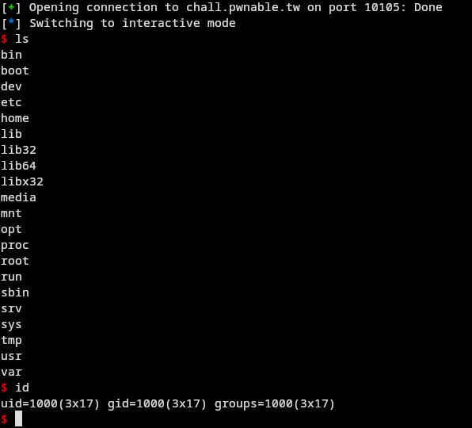
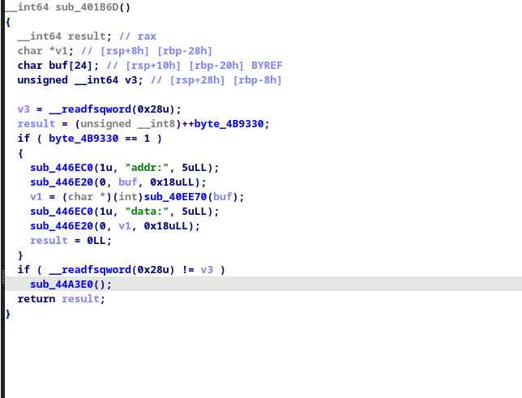

# Image 1

# Image 2


# 3x17 — pwnable.tw

A binary exploitation solution for the `3x17` challenge, focusing on an arbitrary-write primitive, `.fini_array` manipulation, and Return-Oriented Programming (ROP).

## Challenge

- Platform: [pwnable.tw](https://pwnable.tw/challenge/)
- Challenge: `3x17`
- Architecture: x86-64 (AMD64)
- Category: Pwn / Binary Exploitation
- Exploit: `exploit.py`
- Techniques: arbitrary memory write, `.fini_array` hijacking, ROP, control-flow redirection

## Overview

The central challenge is to turn a memory-write primitive into controlled code execution. Instead of relying on a traditional stack buffer overflow, the exploitation strategy uses writes to selected memory locations to influence program termination and redirect execution.

The key idea is to manipulate `.fini_array`, an ELF section containing function pointers associated with program termination, and use that control-flow change to reach a ROP chain.

## Exploitation Approach

1. **Inspect the ELF** — verify the architecture, executable layout, relevant sections, and security mitigations.
2. **Understand the write primitive** — determine how the target accepts a destination address and data, and establish the exact write constraints.
3. **Locate `.fini_array`** — inspect the section and identify which entries influence termination behavior.
4. **Redirect control flow** — use the write primitive to alter the relevant function-pointer entries.
5. **Prepare the ROP chain** — place the required chain and data in suitable writable memory, validating every address against the challenge binary.
6. **Trigger and verify** — confirm that the intended execution path is reached in the challenge environment.

## Technical Concepts

### `.fini_array`

In ELF binaries, `.fini_array` stores function pointers used during program termination. If the relevant memory is writable and the program's termination path reaches those entries, modifying them can influence which code executes.

### Arbitrary Write Primitive

A write primitive allows data to be written to a selected memory address. Its practical power depends on the permitted destination range, write size, input constraints, and whether the target remains usable for subsequent writes.

### Return-Oriented Programming

ROP chains existing instruction sequences together to perform operations without requiring injected executable code. The exact gadgets and addresses depend on the binary being exploited.

## Requirements

- Python 3
- pwntools
- The matching challenge binary or the intended remote challenge environment
- ELF inspection and debugging tools, such as `file`, `readelf`, and GDB

Install pwntools:

```bash
python3 -m pip install pwntools
```

## Run

```bash
python3 exploit.py
```

The script targets the challenge environment. For local analysis, use the matching binary and verify the addresses and memory layout before running the exploit.

## Key Takeaways

- An arbitrary write can be more powerful than a conventional buffer overflow when it reaches security-sensitive control data.
- ELF termination handlers are part of the program's control-flow surface.
- ROP requires careful validation of gadget addresses, writable memory, and execution order.
- A robust write-up should explain why each memory modification is necessary and how the result was verified.

## Scope

This project is intended for learning and authorized CTF practice. Use it only against the designated challenge or an environment you are authorized to test.

## References

- [pwnable.tw — Challenge platform](https://pwnable.tw/challenge/)
- [pwntools documentation](https://docs.pwntools.com/)
- [ELF specification overview](https://refspecs.linuxfoundation.org/elf/elf.pdf)

## Disclaimer

Educational research only. The exploit is intended for the specified challenge environment, not for unauthorized systems.
